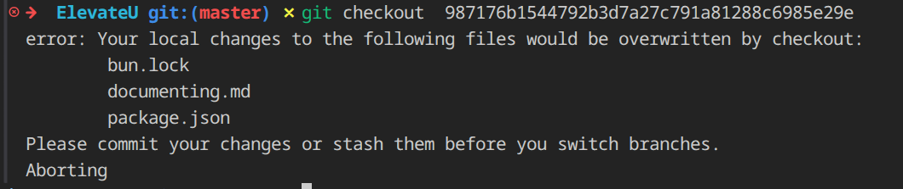

## TODO 


TABS 
### Chatbot 
- Delete Chat button 
- Different Sessions 
- Add context of previous messages 
- markdown Text messages  


----------


### Assessment  -- 6 Aug 

- Upload file 
- Read file content 
- Send file content to AI 
- receive ATS score response 
- Display ATS score 


### Roadmaps 
- 1 detailed TASK 
- 1 detailed Project 
- Add status of both 
- Make  them as sub-tasks , by simply having an Property 

### Profile - P4 

---------- 

Date : 2026-08-04 20:12 

### Add EnrichedMarkdownText for markdown for the AI response 
- requires Prebuild , wont work on Expo Go 

04/08/2026


31 oct 
- remove branch react-native-expo-dark-mode-ui-3579f 
``` terminal
 // delete branch locally
git branch -d localBranchName

// delete branch remotely
git push origin --delete remoteBranchName 
```
- Upgrade Expo sdk version 
` bun install expo@^58.0.0 ` 

- Fix Error by undoing last 2 commits 
` git reset --soft <commit_has> `

- add supabase

` bun expo install expo-auth-session expo-crypto `
` bun expo install @react-native-async-storage/async-storage `  

## 12 Nov 

### Error 1 : 
- Node.js v24.15.0 
error: script "start" exited with code 7
- Reason : idk 

- fix : temporarily fix is to just use `bunx expo start --tunnel` 


## 13 Nov 

- git stash : 
- 